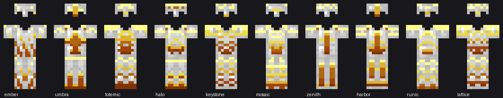

# Extra Trims

A Fabric mod for **Minecraft 1.21.11** that adds ten new armor trim patterns,
each with its own smithing template that generates in a structure suited to it.



*The ten patterns, shown in gold on iron armour. All sixteen vanilla trim
materials work; `docs/preview-amethyst.png` shows the same set in amethyst.*

## The patterns

| Pattern | Design | Found in | Duplicate with | Coverage |
|---|---|---|---|---|
| Ember | Flecks banked at the hem, guttering out upwards | Ruined portal chests | Magma block | 24% |
| Zenith | A long thin cross with a single crossbar | Bastion treasure chests | Blackstone | 27% |
| Mosaic | A centred vertical stack of tiles | Desert pyramid chests | Sandstone | 33% |
| Runic | Nested arches under bold shoulder bars | Stronghold library chests | End stone bricks | 33% |
| Halo | A shallow arch over a triangular tent | End city treasure chests | Purpur block | 36% |
| Harbor | A mast with two spars widening downward | Shipwreck treasure chests | Oak planks | 37% |
| Keystone | Dense masonry blocks, bracketed shoulders | Stronghold corridor chests | Stone bricks | 41% |
| Umbra | A chunky cross patee with a plumed helm | Ancient city chests | Deepslate bricks | 42% |
| Lattice | Zigzag rows with hollow shoulder rings | Woodland mansion chests | Dark oak planks | 42% |
| Totemic | A tapering stack with a bold wing bar | Jungle temple chests | Mossy cobblestone | 45% |

Coverage is the share of the armour's 648-pixel footprint the trim paints on.
Vanilla ranges from 11% (shaper) to 63% (silence).

Every pattern is shaded across five or six steps of the trim material's
palette rather than painted in one flat tone, so a gold trim runs from a pale
highlight down to a dark brown and an amethyst one from lilac to deep purple.
Each pattern picks a lighting style: `relief` catches the light on edges and
drops undersides into shadow, `strata` steps a shade deeper every two rows,
and `depth` fades from lit shoulders to a dark hem.

Templates are applied at a smithing table exactly like vanilla ones, work with
all sixteen vanilla trim materials, and duplicate with the same
seven-diamond-plus-base-block recipe vanilla uses.

## Building

Requires JDK 21.

```sh
./gradlew build
```

The mod jar is written to `build/libs/extratrims-1.0.0.jar`. Install it with
[Fabric Loader](https://fabricmc.net/use/installer) 0.19.5 or newer and
[Fabric API](https://modrinth.com/mod/fabric-api) for 1.21.11.

To run a development client or server:

```sh
./gradlew runClient
./gradlew runServer
```

## How it is put together

Armor trims are almost entirely data-driven in this version, so the Java is
thin and most of the mod is JSON and textures.

- `data/extratrims/trim_pattern/` — the pattern definitions. Since 1.21.5 a
  pattern no longer names its template item; the `minecraft:smithing_trim`
  recipe binds the two together instead.
- `data/extratrims/recipe/` — one `smithing_trim` recipe and one duplication
  recipe per pattern.
- `assets/extratrims/textures/trims/entity/humanoid{,_leggings}/` — the trim
  textures, one pair per pattern. These must use only the eight greys of
  vanilla's `trim_palette.png`: grey index i is recoloured to index i of the
  trim material's own palette, which is what lets one texture carry light and
  shade in every material. Any other colour is left unrecoloured.
- `assets/minecraft/atlases/armor_trims.json` — registers those textures for
  palette swapping. Atlas sources from every pack are merged, so this adds to
  vanilla's list rather than replacing it.
- `ExtraTrimsItems` registers the eight template items. A smithing template
  needs no special item class in this version — it is a plain uncommon item.
- `ExtraTrimsLoot` adds each template to its structure's loot table through
  Fabric's `LootTableEvents.MODIFY`, so no vanilla file is overwritten.

## Regenerating assets

The textures and JSON are generated, so adding a pattern means editing two
tables rather than hand-writing a dozen files.

```sh
# Trim textures. Needs the vanilla armour textures as a mask source; point
# --masks at a directory containing assets/minecraft/textures/entity/equipment/
python3 tools/generate_textures.py --masks /path/to/extracted/client

python3 tools/generate_items.py    # smithing template icons and the mod icon
python3 tools/generate_data.py     # trim patterns, recipes, models, lang, atlas
python3 tools/validate.py          # consistency checks over everything above

# Re-render the preview sheets in docs/
python3 tools/preview.py --vanilla /path/to/extracted/client --material gold \
    --out docs/preview-gold.png
```

Patterns are hand-authored pixel art: `generate_textures.py` holds one small
bitmap per kind of armour face (`helm`, `body`, `arm`, `leg`, `side`) per
pattern, painted into the standard UV boxes and masked to the armour. Ember
is the exception and stays a procedural motif.

The bitmaps are written for the full 12-row box, but each armour piece only
shows part of it, which is worth knowing before drawing: the chest shows rows
0-10 and has a neck cutout across rows 0-1, arms show only rows 0-5, leggings
legs rows 0-8, boots rows 6-11, and the leggings belt rows 7-11.

Art is written as shapes, not tones: `#` means "shade this automatically"
and the pattern's entry in `STYLES` decides how. A digit `0`-`4` pins one
step of the ramp by hand where a shape needs it.

To add a pattern: add its bitmaps to `ART` in `generate_textures.py` with a
style in `STYLES`, a glyph and colour to `generate_items.py`, a row to
`PATTERNS` in `generate_data.py`, and a placement in `ExtraTrimsLoot`.

## Licence

MIT, see [LICENSE](LICENSE).
